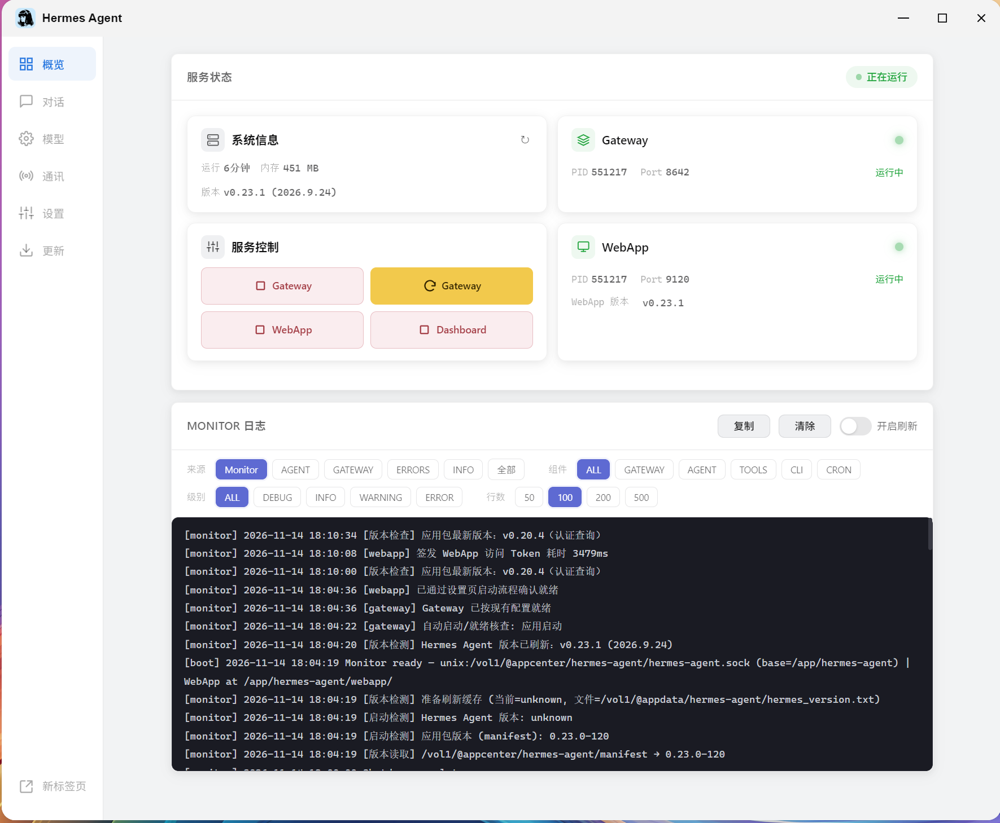
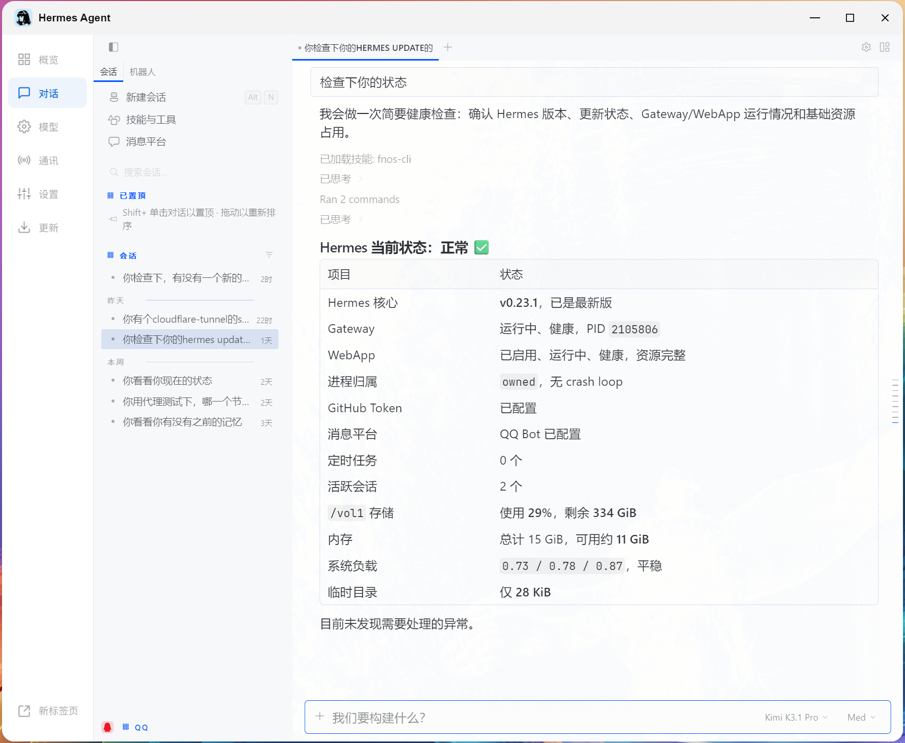
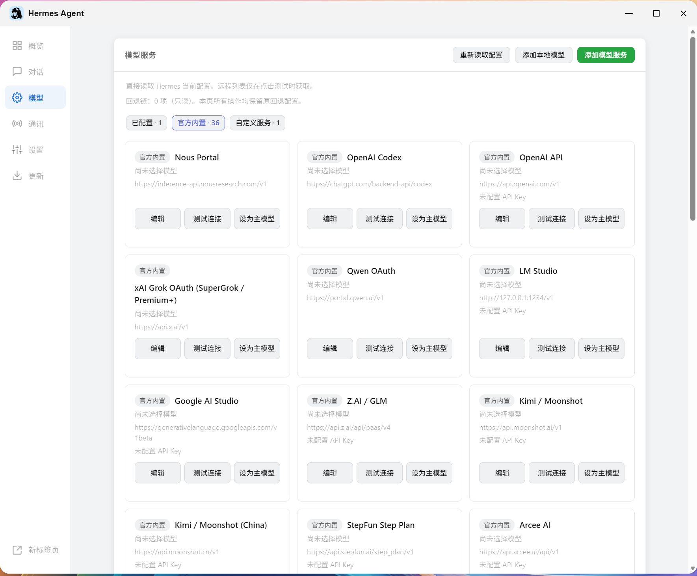
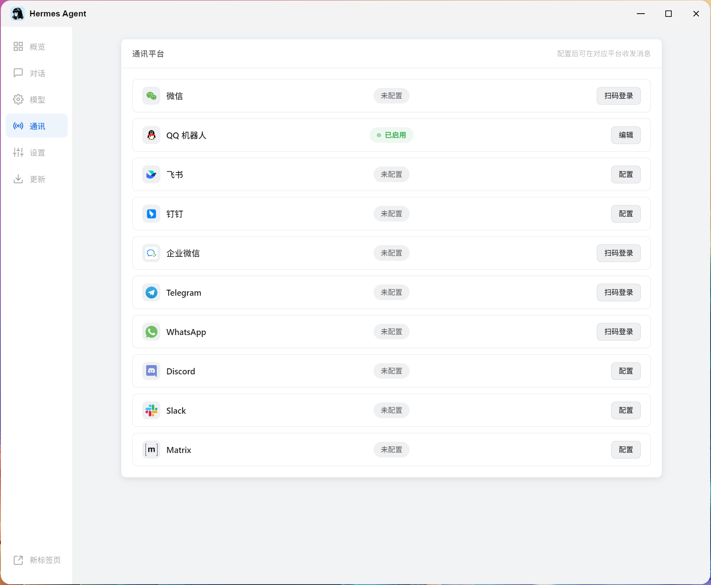
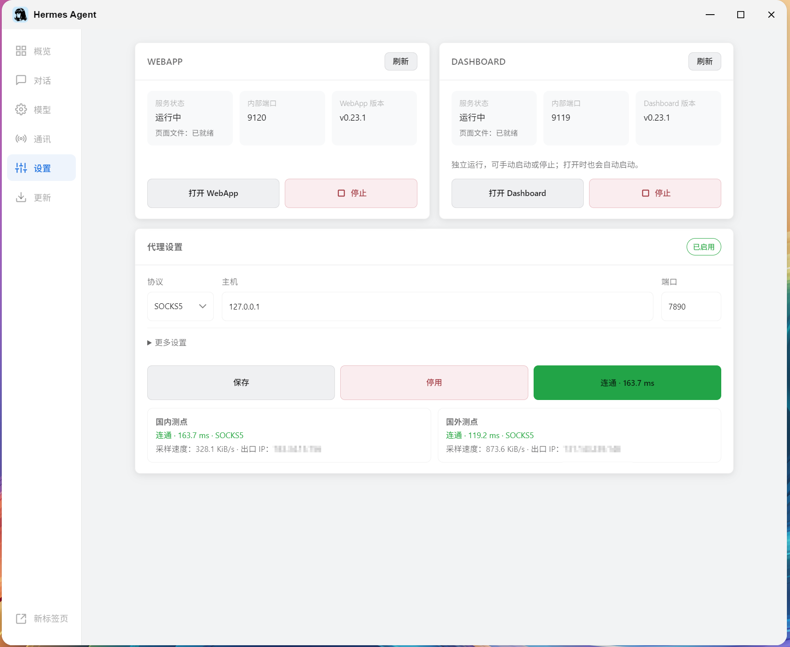
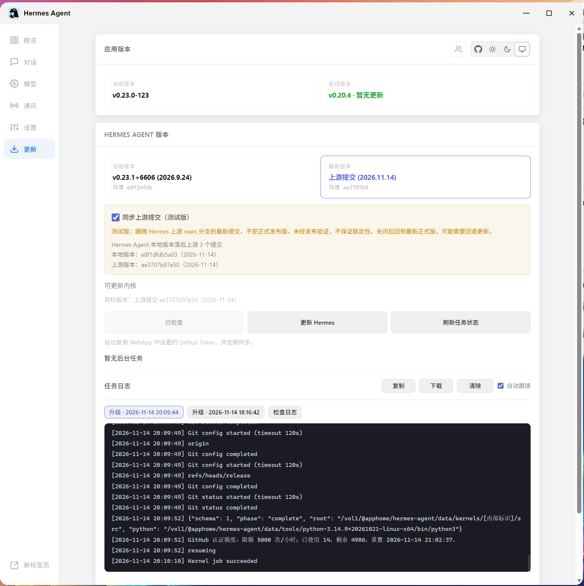

# Hermes Agent for fnOS

[](LICENSE)
[]()
[]()

Hermes Agent 是专为适配飞牛 NAS（fnOS）的 AI 助手应用，通过原生`fpk` 应用中心部署。采用基于 Node.js 的 Monitor 服务进行进程管理，提供基于 Web 的控制面板用于配置和对话交互。

## 新版亮点

这一版的对话页换成了 Hermes 上游官方 WebApp，管理面板只负责配置、服务和更新。

- **官方 WebApp**：「对话」页内嵌的就是上游官方 WebApp，源码固定到上游的版本标签和提交。界面和交互跟上游一致，本项目只补了手机触屏适配，并关掉了它自带的更新入口。
- **访问更安全**：WebApp 经应用自己的代理打开，每个请求都核对 fnOS 管理员身份，Gateway 端口只在本机使用。
- **打开更快**：WebApp 在运行时，面板会在后台先加载对话页，点「对话」就能直接用。在同一个浏览器标签页里重开面板，会沿用上次的登录，新开标签页会自动重新登录一次。
- **手机适配**：模型选择里的搜索框、收藏星标和关闭按钮按触屏重新调整过，轻点就能操作。
- **连接更稳**：网络短暂切换或手机切到后台时，面板先保留上一次的服务状态。
- **更新跟进**：更新页可选稳定版，也可以开启「同步上游提交」跟随上游 main 分支，并显示本机落后多少个提交。注意 main 分支不是正式发布版。


## 功能特性

* 支持多通讯渠道接入（微信、QQ 机器人、飞书、WhatsApp、Telegram），网页内扫码绑定，渠道独立启停
* 支持网页端对话（内嵌官方 WebApp），支持完整的 Markdown 输出
* 支持对话传入图片、文件供AGENT分析
* 支持模型回退机制，主模型故障时自动切换备用模型，保障服务连续性
* 可以同时在多个窗口提问，回复超时会自动提醒，在新窗口打开的对话也会继续接收回复

### 环境要求

- 设备架构：支持 x86_64（Intel/AMD）和 ARM（aarch64）
- 可用存储空间：约 1GB（含 Python 依赖包和缓存）
- 依赖项：fnOS 官方 Node.js v26 或更新版本（安装时由应用中心自动处理）
- 网络：安装/升级时需联网下载 Python 运行时与依赖包

### 安装步骤

1. 在飞牛应用中心添加第三方源或直接上传 `.fpk` 安装包
2. 等待安装完成，桌面出现应用图标
3. 点击图标打开控制面板
4. 在「模型」页选择模型供应商并填入 API Key
5. 在「对话」页即可进行对话（WebApp 随应用自动启动）

应用启动后自动监听内部端口，无需手动配置网络，通过应用中心的快捷入口进入。

## 目录结构

```
/var/apps/hermes-agent/home/data/  # 应用数据目录（持久化，升级/重装保留）
├── venv/                          # Python 虚拟环境
│   └── bin/                       # Python 可执行文件（python3、hermes）
├── bin/uv                         # 私有 uv 包管理器
├── python/                        # uv 托管的 CPython 3.14
├── .uv-cache/                     # uv 包缓存
├── config.yaml                    # 主配置文件
├── .env                           # 环境变量（API Key 等）
├── sessions/                      # 会话历史记录
├── skills/                        # 技能库（随版本更新）
├── workspace/                     # 工作区文件（生成的报告、代码等）
├── SOUL.md                        # 系统提示词（首次安装部署）
└── AGENTS.md                      # 执行参考规则（首次安装部署）

/var/apps/hermes-agent/            # 应用运行目录
├── target/                        # 程序本体（监控脚本、静态资源，升级整体替换）
│   ├── server/monitor.js          # Monitor HTTP 服务（Node.js）
│   ├── ui/                        # 前端静态文件
│   └── hermes-agent.sock          # Unix socket（通信端点）
├── home/                          # → /vol1/@apphome/hermes-agent（data/ 所在位置）
└── var/                           # → /vol1/@appdata/hermes-agent（运行时数据，升级保留）
    ├── app.pid                    # Monitor 进程 PID
    ├── gateway.pid                # Gateway 进程 PID
    ├── dashboard.pid              # Dashboard 进程 PID
    ├── monitor.token              # API 认证令牌
    ├── monitor.log                # Monitor 运行日志
    └── info.log                   # 安装/启停日志
```

> `vol1` 为示例，实际卷号由安装时选择的存储空间决定。

## 进程架构

```
应用启动脚本 → Monitor (Node.js, /var/apps/hermes-agent/target/server/monitor.js)
                                         │
                                         ├─► Unix socket: /var/apps/hermes-agent/target/hermes-agent.sock
                                         │                 └─► 控制面板前端 (app/ui/index.html) / 官方 WebApp
                                         │
                                         ├─► HTTP 代理 → Hermes Gateway (:8642)
                                         │                └─► 模型供应商 API / WS 消息通道
                                         │
                                         └─► Dashboard (:9119，按需手动启动)
```

### 服务启停

应用生命周期由 fnOS 统一管理。控制面板可见状态包括：运行中、已停止、启动中。支持在控制面板「概览」页查看进程状态，并提供停止/重启 Gateway、停止 WebApp、启动 Dashboard 等按钮。所有操作均由后台进程管理接口统一调度，避免端口冲突和资源泄漏。应用整体的启动与停止仍在应用中心操作。

### 端口说明
- 启动时会探测端口，如果默认端口**8642**被占用，Gateway 改用**28642**。Dashboard 固定使用**9119**
- **8642** — Hermes Gateway 通信端口（内部使用，不对外暴露）
- **9119** — Dashboard 仪表板端口（本地回环访问）

## 架构设计

控制面板通过基于 HTTP 的 Node.js 服务器（Monitor）通信，该服务器监听 Unix socket（`/var/apps/hermes-agent/target/hermes-agent.sock`）。消息被代理至端口 8642 上的 Hermes Gateway 进程。Python 虚拟环境使用 `uv` 作为包管理器，依赖项在安装时从 PyPI 镜像源拉取（阿里云镜像优先，失败时改用官方 PyPI，uv 与 Python 运行时也优先走国内镜像，GitHub 作为备用），所有下载均按固定 SHA256 校验。

监控令牌（Token）位于 `/vol1/@appdata/hermes-agent/monitor.token`，首次启动时生成随机字符串并持久保存，之后的启动复用同一令牌，前后端通过此令牌鉴权。所有面板请求都要求 fnOS 管理员身份，写操作（配置修改、进程重启）还必须携带有效令牌，只读查询（状态、日志）不需要令牌。

## 更新

检查最新版本：在控制面板「更新」页点击「检查更新」，从 GitHub Release 获取 Hermes 内核最新版本，对比当前版本号后发现新版本即可点击「更新 Hermes」升级（首次使用需先点「构建更新环境」，构建期间会短暂停用服务，用户数据保留）。

## 截图








### QQ 交流群


## Starchart
